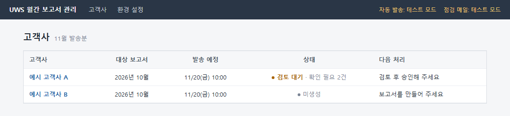
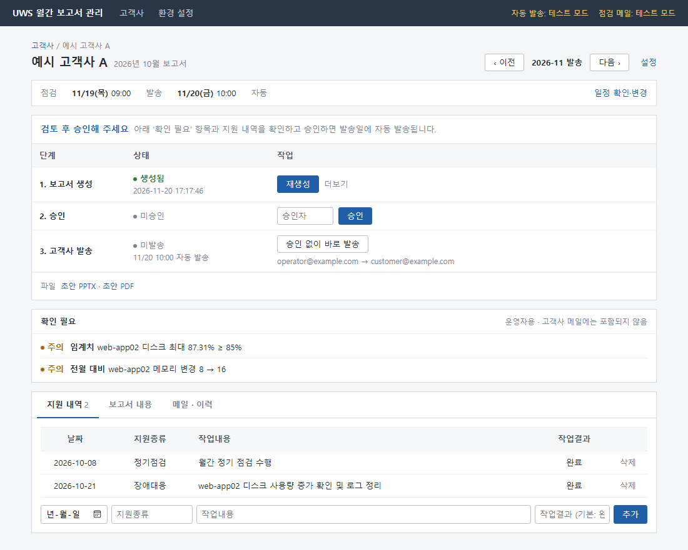
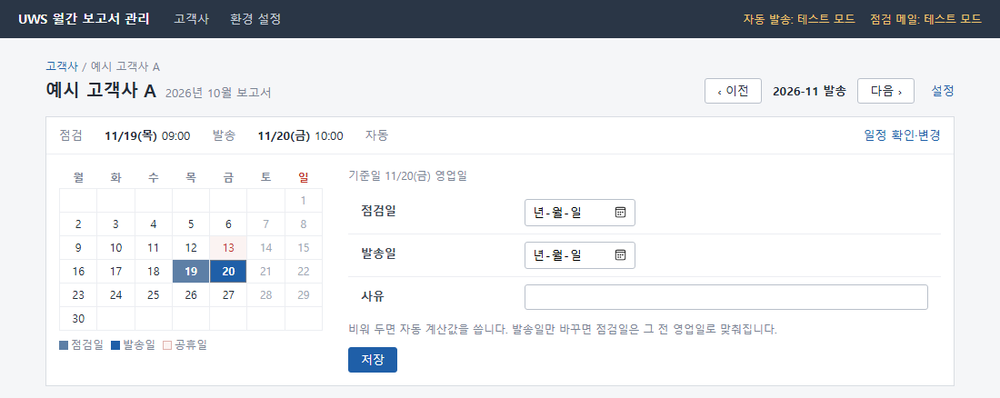
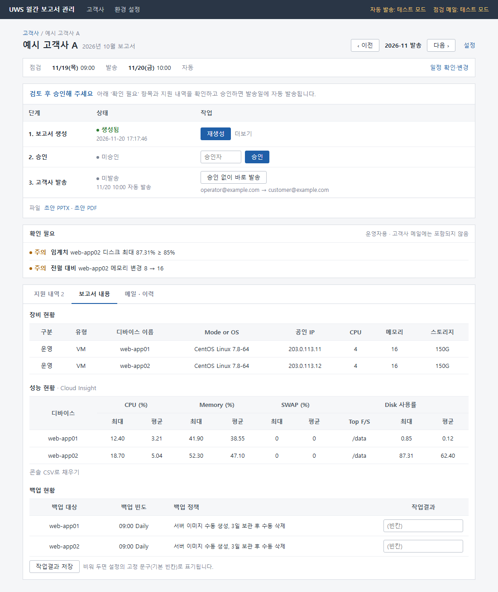
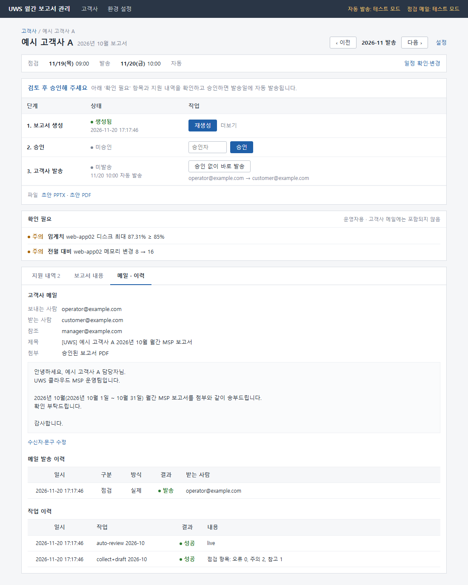
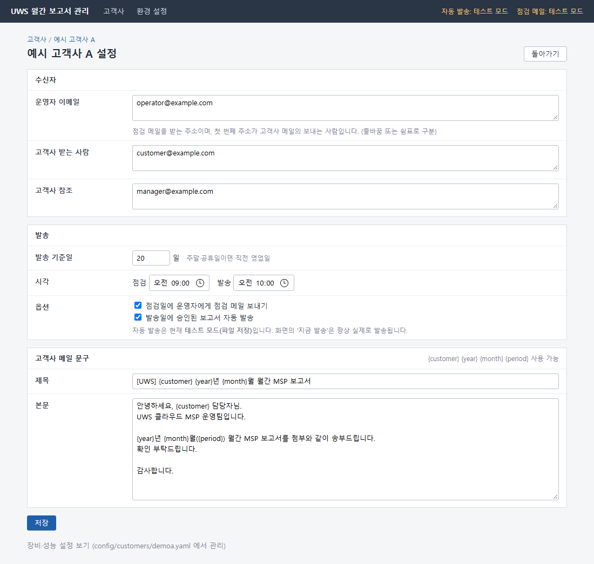
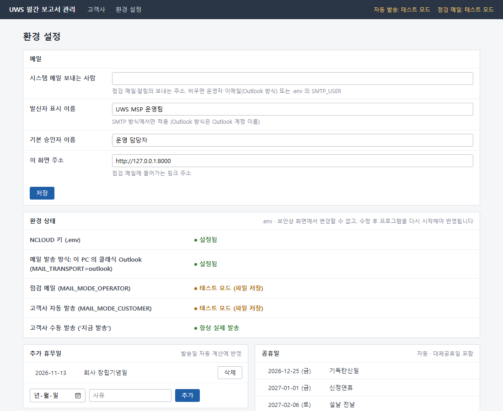

# NCP 월간 MSP 보고서 자동화

NAVER Cloud Platform(NCP) 고객사의 **월간 MSP 보고서**를 자동으로 만들고 발송하는 사내용 웹 프로그램입니다.

기존에는 운영자가 콘솔에서 수치를 확인해 PPT에 옮겨 적고 메일로 보냈습니다. 이 프로그램은 그 과정을
**자동 수집 → 보고서(PPT/PDF) 자동 생성 → 운영자 점검·승인 → 고객사 발송**으로 바꿉니다.

- 고객사 환경은 **조회만** 합니다 (생성·변경·삭제·재시작 호출 없음).
- 보고서는 기존 양식(PPT)을 템플릿으로 쓰고 **값만 채웁니다**. 양식은 기존과 동일합니다.
- 고객사로는 **운영자가 승인한 보고서만** 나갑니다.
- 현재 SK엠앤서비스 1개 고객사에 적용되어 있고, 고객사별 설정 파일을 추가해 확장할 수 있습니다.

---

## 목차
1. [월간 업무 흐름](#1-월간-업무-흐름)
2. [빠른 시작](#2-빠른-시작)
3. [화면별 매뉴얼](#3-화면별-매뉴얼)
4. [메일 발송 구조](#4-메일-발송-구조)
5. [자주 하는 작업](#5-자주-하는-작업)
6. [설정 파일](#6-설정-파일)
7. [명령행(CLI)](#7-명령행cli)
8. [폴더 구조와 데이터 보관](#8-폴더-구조와-데이터-보관)
9. [안전장치](#9-안전장치)
10. [문제 해결](#10-문제-해결)
11. [제한 사항](#11-제한-사항)

---

## 1. 월간 업무 흐름

| 시점 | 동작 | 주체 |
|---|---|---|
| 매일 10:00 | 서버 이미지 목록을 날짜별로 저장 (이미지는 3일만 보관되므로 이력 확보용) | 자동 |
| **점검일** (발송일 직전 영업일, 09:00) | NCP에서 장비·성능 수집 → PPT/PDF 초안 생성 → 운영자에게 점검 메일(선택) | 자동 |
| 점검일 ~ 발송일 | 지원 내역 입력, 수치 확인, **승인** | 운영자 (웹 화면) |
| **발송일** (매월 20일, 주말·공휴일이면 직전 영업일) | **승인된 보고서만** 고객사로 발송 | 자동 또는 수동 |

- 보고서 기간은 **전월 1일 ~ 말일**입니다. 11월 20일 발송분은 10월 1일 ~ 10월 31일 보고서입니다.
- 발송일·점검일은 달력(공휴일 포함)으로 자동 계산하고, 월별로 직접 바꿀 수도 있습니다.

### 보고서 구성 (PPT/PDF)
1. 대상장비 현황 — 구분, 디바이스 유형, 이름, OS, 공인 IP, CPU, 메모리, 스토리지
2. 성능 현황 — CPU·메모리·SWAP·디스크 사용률의 최대/평균 (30분 간격 월 전체 기준, 소수 2자리)
3. 백업 현황 — 대상, 빈도, 정책, 작업결과
4. 지원 내역 — 날짜, 지원종류, 작업내용, 작업결과 (운영자 입력)

---

## 2. 빠른 시작

### 요구 사항
- Windows, Python 3.12
- **PowerPoint** (PDF 변환) — 없으면 LibreOffice로 대체 가능
- **클래식 Outlook** (메일 발송, 기본 방식) — 발송 계정이 설정되어 있어야 함
- NCP CLI (`ncloud`) 설치 및 `ncloud configure` 완료
- NCP API 키 계정에 **조회 권한** (서버 조회 + Cloud Insight 조회 정책 `NCP_CLOUD_INSIGHT_VIEWER`)

### 설치
```powershell
cd ncp-monthly-report
python -m venv .venv
.\.venv\Scripts\python.exe -m pip install -r requirements.txt
```

### 환경 변수 (`.env`)
`.env.example`을 `.env`로 복사한 뒤 값을 채웁니다. **`.env`는 Git에 올라가지 않습니다.**

| 항목 | 설명 |
|---|---|
| `NCLOUD_ACCESS_KEY`, `NCLOUD_SECRET_KEY` | Cloud Insight 조회용 키 (CLI는 `ncloud configure`의 키를 사용) |
| `MAIL_TRANSPORT` | `outlook`(이 PC의 클래식 Outlook으로 발송) 또는 `smtp` |
| `MAIL_MODE_OPERATOR` | 점검 메일: `live`(실제 발송) / `dryrun`(파일로만 저장, 기본) |
| `MAIL_MODE_CUSTOMER` | 고객사 **자동 발송**: `live` / `dryrun` (수동 발송은 항상 실제 발송) |
| `SMTP_HOST`, `SMTP_PORT`, `SMTP_USER`, `SMTP_PASSWORD` | `MAIL_TRANSPORT=smtp`일 때만 사용 |

### 실행
```powershell
.\.venv\Scripts\python.exe app.py
```
브라우저에서 **http://127.0.0.1:8000** 을 엽니다. 종료는 `Ctrl+C`입니다.

- 웹 서버 안에서 **자동 스케줄러**(스냅샷, 점검일 초안, 발송일 발송)가 함께 동작합니다. 자동 처리를 쓰려면 프로그램을 계속 켜 두세요.
- `.env`를 수정한 뒤에는 **프로그램을 재시작**해야 반영됩니다.
- 화면은 **이 PC에서만** 접속할 수 있습니다 (`127.0.0.1`).

---

## 3. 화면별 매뉴얼

> 아래 화면은 **가상의 예시 데이터**(예시 고객사, `example.com` 주소)로 캡처한 것입니다.
> 화면을 바꾼 뒤 이미지를 다시 만들려면 `.\.venv\Scripts\python.exe scripts\capture_docs.py`를 실행하세요 (실제 데이터·메일·NCP와 무관한 임시 환경에서 캡처).

### 3-1. 고객사 목록 (첫 화면)
고객사별 이번 달 진행 상황을 한눈에 봅니다.



- 고객사 이름을 누르면 해당 고객사의 **월 화면**으로 이동합니다.
- **상태**에 "검토 대기 · 확인 필요 2건"처럼 지금 단계와 점검에서 걸린 항목 수가 함께 보이고, **다음 처리**에는 지금 해야 할 일이 한 줄로 나옵니다 (예: "보고서를 만들어 주세요", "검토 후 승인해 주세요", "승인 완료 · 자동 발송 대기 중").
- 맨 위 오른쪽의 노란 글씨는 메일이 **테스트 모드**일 때만 나타납니다 (실제 발송 모드이면 표시되지 않음).

| 열 | 설명 |
|---|---|
| 고객사 | 클릭하면 월 화면으로 이동 |
| 대상 보고서 | 이번 발송분이 해당하는 보고 월 (예: 11월 발송 → 10월분) |
| 발송 예정 | 발송일과 시각 |
| 상태 | 미생성 / 검토 대기 / 승인됨 / 발송 완료 (+ 확인 필요 건수) |
| 다음 처리 | 지금 해야 할 일 |

상단 바에는 메일이 **테스트 모드**일 때만 노란 글씨로 안내가 표시됩니다.

### 3-2. 월 화면 (핵심 화면)
고객사 이름을 눌러 들어갑니다. `‹ 이전 / 다음 ›`으로 다른 달로 이동합니다.



**화면 구성 (위에서 아래로)**
1. **상단 바** — 메뉴(고객사 / 환경 설정)와 메일 테스트 모드 안내
2. **제목 줄** — 고객사 이름과 보고 월, 발송 월 이동(`‹ 이전` `다음 ›`), `설정`(고객사 설정으로 이동)
3. **일정 줄** — 점검일·발송일 요약. 누르면 달력과 변경 폼이 펼쳐집니다
4. **진행 표** — 맨 위에 "지금 해야 할 일", 그 아래 3단계(보고서 생성 · 승인 · 고객사 발송)의 상태와 버튼, 맨 아래에 초안/승인본 파일 링크
5. **확인 필요** — 운영자용 점검 결과 (문제가 있을 때만 표시)
6. **탭** — 지원 내역 / 보고서 내용 / 메일·이력

#### ① 일정 (맨 위 한 줄)
`점검 11/19(목) 09:00 · 발송 11/20(금) 10:00 · 자동`



- 왼쪽 달력에서 점검일(회청색), 발송일(진한 파랑), 공휴일(빨강 배경)을 확인합니다. 위 예시는 11월 13일이 **추가 휴무일**로 등록되어 있어 빨강으로 표시된 것입니다.
- 오른쪽은 일정 변경 폼입니다. 맨 위 회색 글씨는 자동 계산 근거입니다 (예: "기준일 11/20(금) 영업일", 주말이면 "기준일 12/20(일) 주말 → 직전 영업일 12/18(금)").

- 줄을 누르면 **달력과 변경 폼**이 펼쳐집니다. 점검일은 파랑, 발송일은 진한 파랑, 공휴일은 빨강으로 표시됩니다.
- 기본 규칙: 기준일(20일)이 주말·공휴일이면 직전 영업일에 발송, 점검일은 발송일 직전 영업일.
- **직접 바꾸려면** 점검일·발송일·사유를 입력하고 저장합니다. 비워 둔 항목은 자동 계산값을 씁니다. 발송일만 바꾸면 점검일은 그 전 영업일로 맞춰집니다. "자동으로 되돌리기"로 원래대로 돌립니다.

#### ② 진행 표 (3단계)
맨 위 한 줄이 **지금 해야 할 일**을 알려 줍니다. 아래 표에서 단계별 상태와 버튼을 한 줄에서 처리합니다.

| 단계 | 버튼 | 동작 |
|---|---|---|
| **1. 보고서 생성** | 보고서 생성 / 재생성 / 다시 만들기 | NCP에서 장비·성능을 수집해 PPT/PDF 초안 생성 (약 20초). 지원 내역·백업 결과를 바꾼 뒤에는 "다시 만들기" |
| | 더보기 → 재수집 없이 재생성 | 수집은 건너뛰고 입력값만 반영해 다시 생성 |
| | 더보기 → 점검 메일 발송 | 운영자에게 점검 메일 수동 발송 |
| **2. 승인** | 승인 (승인자 이름 입력) / 승인 취소 | 승인하면 그 시점의 PDF가 `approved` 폴더에 복사·고정됩니다 |
| **3. 고객사 발송** | **지금 발송** (승인된 상태) | 확인창(받는 사람·보내는 사람 표시) 후 **실제 발송** |
| | 승인 없이 바로 발송 (승인 전) | 승인과 발송을 한 번에 처리 (점검·승인 단계 생략) |
| | 더보기 → 발송 상태 초기화 (발송 완료 후) | 시험·재발송용. 확인 칸에 `초기화`를 입력해야 하며 승인도 해제됨 |

- 표 아래 **파일** 링크에서 초안 PPTX/PDF, 승인본 PDF를 내려받습니다.
- 작업이 진행 중이면 상단에 "작업 중"이 표시되고 5초마다 자동 갱신됩니다.

#### ③ 확인 필요 (문제가 있을 때만 표시)
운영자용 점검 결과이며 **고객사 메일에는 포함되지 않습니다.**

- 값 누락, 임계치 초과(CPU·메모리 80%, 디스크 85% 이상), 전월 대비 서버·사양·IP 변경, 지원 내역 미입력 등.
- 항목 오른쪽 링크(작업결과 지정 / 입력 / CSV로 채우기)를 누르면 해당 탭으로 이동합니다.
- 오류가 남은 채 승인하면 한 번 더 확인창이 뜹니다.

#### ④ 탭
**지원 내역**
- 날짜(보고 월 범위 안), 지원종류, 작업내용, 작업결과(비우면 "완료")를 입력해 추가하고, 오른쪽 "삭제"로 지웁니다.
- 지원 내역이 없는 달은 비워 두어도 됩니다 (점검에 "주의"로만 표시).
- 내역을 바꾸면 초안이 오래된 것이 되므로 **다시 만들기** 후 승인합니다.

**보고서 내용**



- 장비 현황, 성능 현황, 백업 현황을 화면에서 확인합니다 (PPT에 들어가는 값과 동일).
- **콘솔 CSV로 채우기:** API 대신 Cloud Insight 콘솔의 CSV(위젯 데이터 다운로드)를 올려 성능 값을 채울 수 있습니다.
- **백업 작업결과:** 서버별로 직접 입력하면 보고서에 표기됩니다. 비워 두면 설정의 고정 문구(기본 빈칸)가 표기됩니다.

**메일 · 이력**



- **고객사 메일** 미리보기: 보내는 사람, 받는 사람, 제목, 본문, 첨부 (발송 전에 그대로 확인)
- 메일 발송 이력(점검/고객사/알림/시험/초기화, 실제·테스트, 성공·실패)과 작업 이력

### 3-3. 고객사 설정
월 화면 오른쪽 위 **설정**.



위에서부터 **수신자 → 발송(일정·옵션) → 메일 문구** 순서이고, 맨 아래 `저장`을 눌러야 반영됩니다.

| 영역 | 항목 | 설명 |
|---|---|---|
| 수신자 | 운영자 이메일 | 점검 메일·알림을 받는 주소. **첫 번째 주소가 고객사 메일의 보내는 사람** |
| | 고객사 받는 사람 / 참조 | 고객사 담당자 주소 (여러 개는 줄바꿈 또는 쉼표) |
| 발송 | 발송 기준일 | 매월 몇 일 (기본 20일). 주말·공휴일이면 직전 영업일 |
| | 점검 시각 / 발송 시각 | 초안 생성·점검 메일 시각 / 자동 발송 시각 |
| | 옵션 | 점검일에 점검 메일 보내기, 발송일에 승인된 보고서 자동 발송 |
| 메일 문구 | 제목 / 본문 | 치환자 `{customer}` `{year}` `{month}` `{period}` 사용 가능 |

- 맨 아래 "장비·성능 설정 보기"는 서버 목록 등 설정 파일 내용을 보여 줍니다 (수정은 파일에서).
- 이메일 형식이 틀리거나 문구의 치환자가 잘못되면 저장되지 않고 오류가 표시됩니다.

### 3-4. 환경 설정
상단 **환경 설정**.



- **환경 상태** 표에서 NCP 키 설정 여부, 메일 발송 방식(Outlook/SMTP), 점검 메일·자동 발송의 실제/테스트 모드를 확인합니다. "고객사 수동 발송(지금 발송)"은 모드와 무관하게 **항상 실제 발송**으로 표시됩니다.
- 아래쪽 왼쪽은 회사 휴무일 등록, 오른쪽은 자동으로 불러온 공휴일 목록입니다 (그림은 일부만 표시).

- **메일:** 시스템 메일 보내는 사람(비우면 운영자 이메일 사용), 발신자 표시 이름(SMTP 방식만), 기본 승인자 이름, 이 화면 주소(점검 메일의 링크용)
- **환경 상태:** `.env` 설정 여부와 메일 방식(값은 표시하지 않음). 비밀정보와 메일 방식은 화면에서 바꿀 수 없고 `.env` 수정 후 재시작합니다.
- **추가 휴무일:** 회사 휴무일 등을 등록하면 발송일 자동 계산에 반영됩니다.
- **공휴일:** 대체공휴일을 포함한 한국 공휴일 목록 (자동)

---

## 4. 메일 발송 구조

두 종류의 메일을 같은 발송 모듈이 처리합니다.

| | 점검 메일 | 고객사 보고 메일 |
|---|---|---|
| 목적 | 운영자가 내용 확인 후 승인 | 고객사에 보고서 전달 |
| 보내는 사람 | 운영자 주소 | **운영자 주소** (설정의 첫 번째 주소) |
| 받는 사람 | 운영자 | 고객사 담당자 |
| 첨부 | 초안 PPTX + PDF | **승인된 PDF** |
| 점검 요약 | 포함 | **미포함** |
| 나가는 시점 | 점검일 (자동/수동) | 발송일 (자동/수동), 승인 필요 |

### 발송 방식 (`MAIL_TRANSPORT`)
- **`outlook` (기본):** 프로그램이 이 PC의 **클래식 Outlook**을 자동 조작해 메일을 작성·발송합니다.
  - 운영자 본인이 Outlook에서 보낼 때와 같은 권한·계정으로 나가며 보낸 편지함에 남습니다. 프로그램은 비밀번호를 다루지 않습니다.
  - Outlook이 꺼져 있으면 백그라운드로 잠깐 실행했다 닫습니다.
  - 필요: PC가 켜져 있고 Windows에 로그인된 상태, 클래식 Outlook에 발송 계정이 설정된 상태.
- **`smtp`:** SMTP 서버에 로그인해 발송. 회사 정책(Microsoft 365의 SMTP 인증 비활성화)으로 막혀 있으면 사용할 수 없습니다.

### 실제 발송 vs 테스트 모드
| 동작 | 방식 |
|---|---|
| 화면의 **지금 발송 / 승인 없이 바로 발송** | **항상 실제 발송** |
| 점검 메일 | `MAIL_MODE_OPERATOR` |
| 고객사 **자동 발송** | `MAIL_MODE_CUSTOMER` (`dryrun`이면 발송하지 않고 `.eml` 파일로만 저장) |

### 자동 발송이 동작하는 조건
1. 프로그램이 켜져 있음 (스케줄러가 30초마다 확인)
2. 고객사 설정에서 **자동 발송이 켜짐**
3. 오늘이 **발송일**이고 **발송 시각이 지남**
4. 보고서가 **승인된 상태**이고 받는 사람이 설정되어 있음
5. 오늘 같은 방식으로 아직 시도하지 않음 (**하루 한 번만 시도**, 실패도 시도로 계산)

승인이 안 되어 보낼 수 없으면 고객사에는 보내지 않고 운영자에게 **[발송보류] 알림 메일**을 보냅니다. 발송일 **당일에만** 시도하며, 프로그램이 꺼져 있었다면 그날은 놓치므로 화면에서 직접 발송하세요.

---

## 5. 자주 하는 작업

### 정상 월 운영 (자동 흐름)
1. 점검일 아침: 초안이 자동 생성되고 점검 메일이 도착합니다.
2. 월 화면에서 **확인 필요**와 **보고서 내용**을 확인하고, **지원 내역**을 입력합니다.
3. 입력을 바꿨다면 **다시 만들기** → **승인**.
4. 발송일 시각에 자동 발송됩니다. (자동 발송을 끈 경우 **지금 발송**)

### 점검 절차 없이 바로 보내기
1. 월 화면에서 **보고서 생성**.
2. 내용 확인 후 **승인 없이 바로 발송** → 확인창에서 받는 사람 확인 후 발송.
(점검 메일 자체를 끄려면 고객사 설정에서 "점검일에 운영자에게 점검 메일 보내기"를 해제합니다.)

### 발송일을 바꾸고 싶을 때
월 화면 상단 일정 줄을 눌러 **점검일·발송일**을 지정하고 저장합니다.

### 시험 발송 후 다시 시험하고 싶을 때
1. 받는 사람을 **본인 주소**로 설정합니다 (고객사 설정).
2. 이미 발송한 달은 **더보기 → 발송 상태 초기화** (`초기화` 입력).
3. 다시 승인 후 발송합니다. 발송 이력은 지워지지 않고 초기화 기록이 남습니다.
4. 시험이 끝나면 실제 고객사 주소로 바꾸고, 운영 중에는 초기화를 쓰지 않습니다.

### 성능 수치를 API 대신 CSV로 채울 때
Cloud Insight 콘솔 → 위젯 데이터 다운로드로 CPU/MEMORY/DISK(/SWAP) CSV를 받아, 월 화면 **보고서 내용 → 콘솔 CSV로 채우기**에서 올립니다.

---

## 6. 설정 파일

| 파일 | 내용 |
|---|---|
| `config/config.yaml` | 전역 설정: NCP CLI 경로·리전, Cloud Insight 주소, 웹 주소·포트, 스케줄러 시각, 저장 경로 |
| `config/customers/<고객사>.yaml` | 고객사별 설정: 시스템 그룹·서버 목록(구분·유형·디스크), OS 표기 매핑, 백업 정책·고정 문구, 성능 지표, 임계치, PPT 템플릿 |
| `templates/<고객사>_template.pptx` | 보고서 템플릿 (원본 양식) |
| `data/app.db` | 화면에서 바꾸는 값(수신자, 일정, 지원 내역 등)과 상태·이력 (SQLite) |

**새 고객사 추가:** `config/customers/`에 yaml 파일을 추가하고 템플릿 PPT를 `templates/`에 둡니다.
**서버·OS 표기 변경:** 해당 고객사 yaml에서 수정합니다 (표시 이름 매핑 예: `CNTOS.0708 → CentOS Linux 7.8-64`).

---

## 7. 명령행(CLI)

화면 없이 실행할 때 사용합니다. 월은 **보고 대상 월**(`YYYY-MM`)입니다.

```powershell
.\.venv\Scripts\python.exe main.py web                                  # 웹 + 자동 스케줄러
.\.venv\Scripts\python.exe main.py snapshot                             # 서버 이미지 스냅샷
.\.venv\Scripts\python.exe main.py draft --month 2026-10                # 수집 + 초안 생성
.\.venv\Scripts\python.exe main.py draft --month 2026-10 --no-recollect # 재수집 없이 재생성
.\.venv\Scripts\python.exe main.py review-mail --month 2026-10          # 점검 메일
.\.venv\Scripts\python.exe main.py approve --month 2026-10 --by 이름    # 승인
.\.venv\Scripts\python.exe main.py send --month 2026-10 [--live]        # 고객사 발송 (승인본만)
.\.venv\Scripts\python.exe main.py schedule --send-month 2026-12        # 발송 일정 계산
```

---

## 8. 폴더 구조와 데이터 보관

```
ncp-monthly-report/
├─ app.py                 웹 서버 + 스케줄러 진입점
├─ main.py                명령행 진입점
├─ config/                전역·고객사 설정
├─ templates/             보고서 PPT 템플릿
├─ src/
│  ├─ ncloud_cli.py       조회 전용 NCP CLI 래퍼 (허용 API 화이트리스트)
│  ├─ collect_cli.py      서버·스토리지·이미지 수집, 장비 현황 변환
│  ├─ collect_insight.py  Cloud Insight 성능 수집 (서명 v2, 조회 전용)
│  ├─ perf_csv.py         콘솔 CSV 성능 반영
│  ├─ snapshot.py         매일 이미지 스냅샷, 백업 현황
│  ├─ validate.py         운영자 점검 항목
│  ├─ render_pptx.py      템플릿에 값 채우기 (python-pptx)
│  ├─ to_pdf.py           PPTX → PDF (PowerPoint / LibreOffice)
│  ├─ mailer.py           메일 발송 (Outlook / SMTP, dry-run)
│  ├─ pipeline.py         수집→생성→점검→승인→발송 핵심 로직
│  ├─ schedule.py         발송일·점검일 계산 (공휴일 포함)
│  ├─ jobs.py             백그라운드 작업·자동 스케줄러
│  └─ db.py               설정·상태·이력 저장 (SQLite)
├─ web/                   화면 템플릿과 스타일
├─ tests/                 자동 테스트
├─ scripts/check_secrets.py   키 노출 검사
├─ scripts/capture_docs.py    README 화면 캡처 생성 (가상 데이터)
├─ docs/images/           README 화면 이미지
├─ reports/<고객사>/<월>/     생성 파일 (Git 제외)
│    ├─ raw/              NCP 원본 응답(JSON)
│    ├─ draft/            초안 PPTX·PDF
│    ├─ approved/         승인본 PPTX·PDF (고객사에 첨부되는 파일)
│    └─ outbox/           보낸 메일 사본(.eml)
├─ data/                  app.db (Git 제외)
└─ logs/                  NCP API 호출 로그 (Git 제외)
```

- 파일은 **이 PC의 폴더**에 저장되며 별도 저장소는 없습니다. DB에는 경로와 상태만 있습니다.
- `reports/`, `data/`, `logs/`, `.env`는 Git에서 제외됩니다. 운영 시에는 `reports/`와 `data/`를 백업 대상에 포함하세요.

---

## 9. 안전장치

- **조회 전용:** NCP CLI는 허용된 조회 API 6개 외 호출을 실행 전에 차단하고, Cloud Insight도 조회 2개 엔드포인트만 허용합니다. 호출은 시각과 함께 `logs/`에 기록됩니다.
- **비밀정보:** 접근키·비밀번호는 `.env`에만 보관하며 Git에 올라가지 않습니다. `scripts/check_secrets.py`로 키 노출을 검사할 수 있습니다.
- **발송 통제**
  - 자동 발송은 **승인된 보고서만** 대상입니다. 수동 발송은 수신자를 보여 주는 확인창이 뜹니다.
  - 승인 후 지원 내역·백업 결과가 바뀌거나 승인본 PDF가 변경되면(해시 검증) 발송이 막힙니다.
  - 같은 달 보고서의 **중복 발송을 차단**하며, 발송이 실패하면 "바로 발송"의 승인은 되돌립니다.
  - 초기화는 이력을 보존하고 확인 문구를 요구합니다.
- **화면 보호:** 이 PC에서만 접속(`127.0.0.1`)할 수 있고 위조 요청(CSRF)을 막습니다.

테스트 실행:
```powershell
.\.venv\Scripts\python.exe -m pytest -q tests
```

---

## 10. 문제 해결

| 증상 | 원인과 조치 |
|---|---|
| 성능 칸이 `-`이고 "Cloud Insight 연결 실패" | `.env`의 NCP 키 확인, 해당 계정에 Cloud Insight 조회 정책(`NCP_CLOUD_INSIGHT_VIEWER`) 부여. 임시로는 콘솔 CSV로 채우기 |
| `code 403 ... getMetric` | 위와 같음 (키 계정의 권한 부족) |
| 성능 조회가 `Throttle`로 실패 | 호출 제한. 자동 재시도하며, 계속되면 잠시 후 재생성 |
| 점검 메일/발송이 실패 `Outlook ... 계정이 없습니다` | 클래식 Outlook에 보내는 주소의 계정이 설정되어 있는지 확인 |
| 발송이 90초 뒤 실패 (보낼 편지함에 남음) | Outlook이 오프라인이거나 로그인 창이 떠 있는지 확인. **재시도 전에 보낸 편지함 확인** (나중에 전송될 수 있음) |
| SMTP `535 ... SmtpClientAuthentication is disabled` | 회사 Microsoft 365에서 SMTP 인증이 꺼져 있음. `MAIL_TRANSPORT=outlook` 사용 |
| "이미 발송됨"으로 막힘 | 같은 달 중복 발송 방지. 시험이면 **발송 상태 초기화** |
| "초안 이후 입력이 바뀌었습니다" | **다시 만들기** 후 재승인 |
| 자동 발송이 안 나감 | 승인 여부, 자동 발송 켜짐, 발송 시각, `MAIL_MODE_CUSTOMER`, 프로그램 실행 여부, 오늘 이미 시도했는지(이력 탭) 확인 |
| `.env`를 바꿨는데 반영 안 됨 | 프로그램 재시작 |
| 같은 포트 사용 오류 | 이미 실행 중인 서버를 종료 후 재시작 |

서버 종료와 재시작:
```powershell
Get-CimInstance Win32_Process -Filter "Name='python.exe'" | Where-Object { $_.CommandLine -match 'app\.py' } | ForEach-Object { Stop-Process -Id $_.ProcessId -Force }
.\.venv\Scripts\python.exe app.py
```

---

## 11. 제한 사항

- **PC 의존:** PDF 변환(PowerPoint)과 메일 발송(Outlook)이 이 PC에서 동작하므로, 자동 발송 시각에 PC와 프로그램이 켜져 있어야 합니다. 상시 서버로 옮기려면 SMTP 릴레이 또는 Microsoft Graph API 같은 IT 허용 방식이 필요합니다.
- **백업 작업결과:** 서버 이미지가 3일만 보관되어 과거 이력을 판정할 수 없어, 기본은 기존 양식처럼 빈칸으로 둡니다. 자동 판정은 고객사 yaml의 `backup.auto_judge: true`로 켤 수 있습니다.
- 공인 IP는 별도 조회 권한이 없으면 서버 목록의 값을 사용합니다.
- 로그인 기능이 없습니다 (로컬 전용). 여러 사람이 원격으로 쓰려면 인증이 필요합니다.
- 임시공휴일은 공휴일 패키지(`holidays`) 업데이트가 필요하며, 회사 휴무일은 환경 설정에서 직접 등록합니다.
